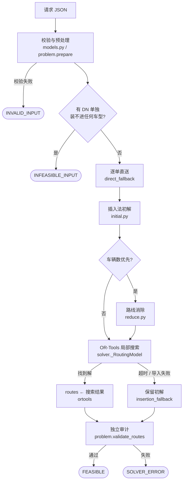
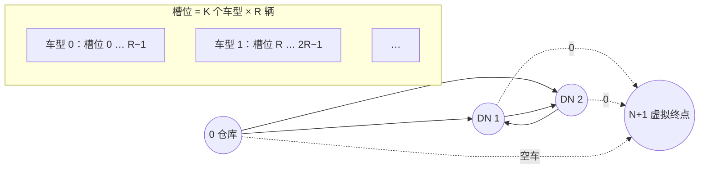

# 算法设计

业务约束见[业务规则](business-rules.md)。本文说明求解流程、各阶段的模型，以及为什么这样设计。

## 符号

| 符号 | 含义 |
|---|---|
| $0$ | 仓库节点 |
| $V = \{1, \dots, N\}$ | 保留下来的 DN 节点 |
| $K$ | 车型数；车型按（容积, 载重, 名称）升序编号为 $k = 0, \dots, K-1$ ，编号即车型等级 |
| $Q^{vol}_k,\ Q^{wt}_k$ | 车型 $k$ 的容积、载重 |
| $q^{vol}_i,\ q^{wt}_i$ | DN $i$ 的体积、重量 |
| $d_{ij},\ t_{ij}$ | 有向距离（×1000 后的整数）、行驶耗时（秒） |
| $[a_i, b_i]$ | DN $i$ 的开始卸货时间窗（相对最早出仓的秒数） |
| $u$ | 每次停靠的卸货时长（秒） |
| $\sigma(i)$ | DN $i$ 的 siteCode |
| $s_i$ | DN $i$ 的开始卸货时间（即输出 eta） |
| $L$ | 出仓时间上限 `latestShippingDate`（未给时为 $H$ ） |
| $H$ | 时间上界 horizon |
| $r = (v_1, \dots, v_m)$ | 一条路线按顺序访问的 DN |

## 设计原则

1. **始终持有一个完整可行解。** 第一步就构造逐单直送方案，之后每个阶段只在得到更好的可行解时替换。
   预算在任何阶段耗尽，都能交付覆盖全部 DN 的结果。
2. **不靠罚分漏单。** 不使用 `AddDisjunction`；每个保留 DN 都是必访节点。
3. **求解器不是可信来源。** 输出前用纯 Python 独立重算全部约束，不依赖 OR-Tools 里的约束编码是否正确。
4. **整数精确。** 距离 ×10³、载荷 ×10⁶ 精确缩放成整数，不能精确表示就报错，不做静默舍入。

## 求解流程



| 阶段 | 预算 | 产出后的 `solutionSource` |
|---|---|---|
| 逐单直送 | — | `direct_fallback` |
| 插入法初解 | $\min(0.2\,T,\ 40\text{ms})$ | `insertion_fallback` |
| 路线消除 | $0.25\,T$ | `insertion_fallback` |
| OR-Tools 搜索 | 剩余全部 | `ortools` |

$T$ 为 `time_limit_ms`；每个阶段的截止时间同时不超过总截止时间。
初解阶段在 `solver._seed_stages` 中按顺序挂接，新增阶段只需在这里加一项。

整体流程（`solver.solve`）：

```text
function SOLVE(payload, T):
    deadline ← now + T
    problem ← PREPARE(VALIDATE(payload))            # 失败 → INVALID_INPUT
    if ∃ i ∈ V: FITTING_VEHICLES({i}) = ∅:
        return INFEASIBLE_INPUT
    routes ← [ ([i], smallest fitting type) for i in V ]   # 逐单直送
    for stage in SEED_STAGES(request):              # 插入初解；车辆数优先再加路线消除
        stage_end ← min(deadline, now + min(stage.cap, stage.share · T))
        routes ← stage.run(problem, routes, stage_end)
    model ← BUILD_ROUTING_MODEL(problem, slots_per_type = |routes|)
    solution ← model.SEARCH(initial = routes, deadline)
    if solution ≠ null:
        routes ← model.ROUTES(solution)             # 每条路线重选最小可装车型
    VALIDATE_ROUTES(problem, routes)                # 失败 → SOLVER_ERROR
    return FEASIBLE(routes)
```

### 1. 校验与预处理（`models.py`、`problem.prepare`）

Pydantic 先校验结构、唯一性、日期格式（当地时间、整秒）。随后按 `(from, to)` 建立矩阵索引并检查冲突，
对角线和同站内部边归零并告警：

$$
\sigma(i) = \sigma(j) \;\Rightarrow\; d_{ij} = t_{ij} = 0
$$

时间窗预检查逐单剔除。窗口为 `[]` 或 $a_i > b_i$ 时记 `EMPTY_TIME_WINDOW`；
最早出仓直送仍晚于窗口上限时记 `DIRECT_TIME_WINDOW_UNREACHABLE`：

$$
t_{0i} > b_i
$$

时间以 `earliestShippingDate` 为零点、单位秒。时间上界取一个足以容纳任何路线的值：

$$
H = \max\bigl(0,\ L,\ \max_i b_i\bigr) + (N+1)\bigl(\max_{i,j} t_{ij} + u\bigr) + 1
$$

无时间窗的 DN 取 $[a_i, b_i] = [0, H]$ ；早于出仓的窗口下限截到 0。
卸货时长 $u = \lceil 3600 \cdot \text{unloadingTime} \rceil$ 。

### 2. 逐单直送

每个 DN 单独一辆车，选最小可装车型。预检查已保证 $t_{0i} \le b_i$ ，且允许等待，
因此直送总是可行，这是一个必然成立的完整解。

### 3. 插入法初解（`initial.py`）

先按 DN 相对仓库的方位角排序（扫描序），让相邻处理的 DN 空间上聚集：

$$
\text{key}(i) = \Bigl(\operatorname{atan2}(\text{lat}_i - \text{lat}_0,\ \text{lon}_i - \text{lon}_0),\ d_{0i},\ i\Bigr)
$$

坐标只决定处理顺序，不参与距离和可行性。然后逐单尝试插入：

```text
function BUILD_INITIAL_ROUTES(problem, deadline):
    routes ← []
    for i in SWEEP_ORDER(V):
        direct ← ([i], smallest fitting type)
        best, best_Δ ← null, (0, 0, 0)               # 与“另开一辆直送车”持平
        for r in routes while now < deadline:
            if not ADMITS(r ∪ {i}): continue          # 容量、站点数：与位置无关，每条路线查一次
            for r' in INSERTIONS(r, i):               # 每个位置；检查站间距离、首段、时间窗
                Δ ← COST(r') − COST(r) − COST(direct)
                if Δ <ₗₑₓ best_Δ: best, best_Δ ← r', Δ
        if best = null: routes.append(direct)       # 无改善或预算耗尽：直送，保证不漏单
        else: replace r with best
    return routes
```

增量 $\Delta$ 按目标优先级组成元组，按词典序比较。设合并后车型为 $k'$ 、原路线车型 $k$ 、直送车型 $k_i$ ：

$$
\Delta =
\begin{cases}
\bigl(-1,\ \Delta d,\ k' - k - k_i - 1\bigr) & \text{车辆数优先} \\
\bigl(\Delta d,\ k' - k - k_i - 1,\ 0\bigr) & \text{距离优先}
\end{cases}
\qquad
\Delta d = \ell(r') - \ell(r) - d_{0i}
$$

其中 $\ell(r) = d_{0 v_1} + \sum_{m} d_{v_m v_{m+1}}$ 为开放路线长度。车辆数优先时首位恒为 −1，
所以只要存在可行插入就一定插入。

### 4. 路线消除（`reduce.py`，仅车辆数优先）

OR-Tools 的局部搜索算子一次只移动少量节点，难以清空一整条路线，车辆数基本停留在初解水平。
这一阶段补上“拆掉整条路线”的复合移动。

车辆数下界（ $G$ 为按计数口径去重的站点组， $Q$ 为 `maxSiteQty`，为 0 时不计最后一项）：

$$
LB = \max\left(
\left\lceil \frac{\sum_i q^{vol}_i}{\max_k Q^{vol}_k} \right\rceil,\
\left\lceil \frac{\sum_i q^{wt}_i}{\max_k Q^{wt}_k} \right\rceil,\
\left\lceil \frac{|G|}{Q} \right\rceil
\right)
$$

```text
function REDUCE_ROUTES(problem, routes, deadline):
    plans ← best ← routes;  stalls ← 0;  rng ← Random(seed = 0)
    while |best| > LB and stalls < 200 and now < deadline:
        smaller ← EMPTY_ONE_ROUTE(plans)
        if smaller ≠ null: plans, stalls ← smaller, 0
        else:              plans, stalls ← SHAKE(plans), stalls + 1
        best ← argmin_{|·|}(best, plans)
    return best (each route with smallest fitting type)

function EMPTY_ONE_ROUTE(plans):
    for victim in 6 shortest routes (ties broken randomly):
        rest ← plans \ {victim}
        if every i in SHUFFLE(victim) can be CHEAPEST_INSERTed into rest:
            return rest                              # 少一辆车
    return null

function SHAKE(plans):                             # 在满载路线之间腾空位
    repeat 20 times:
        pick random routes src ≠ dst and random i ∈ src
        if src \ {i} stays feasible and dst can take i at some feasible position:
            move i from src to dst (first feasible position)
    drop empty routes
```

`CHEAPEST_INSERT` 选距离增量最小的可行位置。每个中间方案都经完整约束检查，随机数固定种子，结果可复现。

### 5. OR-Tools 局部搜索（`solver._RoutingModel`）

#### 图与车辆槽位



- **开放路线**：增加虚拟终点 $N+1$ 作为所有槽位的终点， $d_{i,N+1} = t_{i,N+1} = 0$ 。
- **车辆槽位**：每种车型预留 $R$ 个槽位（ $R$ = 初解路线数），共 $K \cdot R$ 个，按车型分块。
  槽位只是数学表示，不是车源上限：总槽位已是初解车数的 $K$ 倍，足够搜索拆分路线。
  按 $N$ 个槽位建模时，100 单 6 车型仅建模就要约 0.8 秒，见
  [benchmark](benchmark.md#距离优先的车辆槽位2026-10-27)。

#### 目标函数

设 $\mathcal{R}$ 为非空路线集合， $k(r)$ 为路线所在槽位的车型：

$$
\min\ \ C = W_v \cdot |\mathcal{R}| \;+\; W_d \sum_{r \in \mathcal{R}} \ell(r) \;+\; \sum_{r \in \mathcal{R}} \bigl(k(r) + 1\bigr)
$$

实现上，弧成本为 $W_d \cdot d_{ij}$ ，每个槽位的固定成本为 $W_v + k + 1$ 。权重由全局上界推出，保证严格词典序
——高一级目标的一个单位大于所有低级目标之和：

$$
\begin{aligned}
R_{\max} &= N K & &\text{车型等级和的上界} \\
W_d &= R_{\max} + 1 \\
D_{\max} &= N \cdot \max_{i,j} d_{ij} & &\text{总距离的上界} \\
C_{\max} &= W_d \, D_{\max} + R_{\max} & &\text{距离与等级成本的上界} \\
W_v &= \begin{cases} C_{\max} + 1 & \text{车辆数优先} \\ 0 & \text{距离优先} \end{cases}
\end{aligned}
$$

若 $N \cdot W_v + C_{\max} \ge 2^{60}$ ，返回 `OBJECTIVE_OVERFLOW`，避免 int64 溢出。

#### 约束

设 $x_{ij}^{p} = 1$ 表示槽位 $p$ 从 $i$ 直接到 $j$ ， $v(i)$ 为配送 $i$ 的槽位。

**容量**（体积、重量两个维度，每个槽位绑定其车型容量）：

$$
\sum_{i:\,v(i)=p} q^{vol}_i \le Q^{vol}_{k(p)}, \qquad \sum_{i:\,v(i)=p} q^{wt}_i \le Q^{wt}_{k(p)}
$$

**时间**（`Time` 维度，累计值 $s_i$ 即开始卸货时间，松弛量允许等待）：离开一个实际站点时计一次卸货，
同站 DN 之间不计。

$$
x_{ij}^{p} = 1 \;\Rightarrow\; s_j \ge s_i + t_{ij} + u \cdot \mathbb{1}[\sigma(i) \ne \sigma(j)],
\qquad a_i \le s_i \le b_i,
\qquad 0 \le s_{\text{start}(p)} \le L
$$

**同站连续、共用 eta**（`Position` 序位维度 $\pi_i$ ； $c_g(p)$ 为槽位 $p$ 上站点组 $g$ 的 DN 数）。
对同一 siteCode 中任意两单 $i \ne j$ ：

$$
\begin{aligned}
\pi_i - \pi_j &\le c_g\bigl(v(i)\bigr) - 1 + N \bigl(1 - \mathbb{1}[v(i) = v(j)]\bigr) \\
s_i - s_j &\le H \bigl(1 - \mathbb{1}[v(i) = v(j)]\bigr)
\end{aligned}
$$

同车时序位差不超过组大小减一，组内必须连续；两个方向的时间不等式合起来即 $s_i = s_j$ 。不同车时约束放松。

**站点数**（ $G$ 为按计数口径分的组， $Q$ 为 `maxSiteQty`）：

$$
\sum_{g \in G} \max_{i \in g} \mathbb{1}[v(i) = p] \le Q \qquad \forall p
$$

每组只有一个 DN 时退化为计数维度（每个 DN 计 1，累计 ≤ $Q$ ）； $Q = 0$ 或 $Q \ge |G|$ 时省略。

**站间距离上限**（ $\bar d$ 为 `siteDistanceLimit`）：直接从 `NextVar` 中移除禁用后继，仓库出发的边不受限。

$$
i, j \in V,\ d_{ij} > \bar d \;\Rightarrow\; x_{ij}^{p} = 0 \quad \forall p
$$

**首段约束**（`FirstLeg` 预算维度）：出仓存入首段距离，每段站间距离扣减，余额不得为负。

$$
B_1 = d_{0 v_1}, \qquad B_{m+1} = B_m - d_{v_m v_{m+1}} \ge 0
\;\;\Longleftrightarrow\;\;
\sum_{m=1}^{|r|-1} d_{v_m v_{m+1}} \le d_{0 v_1}
$$

首段约束最初用 `solver.Add` 表达，局部搜索过滤器看不到它，插入类算子产生的候选几乎都在最终 CP 检查中被否决。
改成维度后过滤器可直接判断，距离明显改善（见 [benchmark](benchmark.md#首段约束改为预算维度2026-10-27)）。

#### 搜索与读取

```text
function SEARCH(model, initial, deadline):
    if remaining(deadline) ≤ 0: return null
    CLOSE_MODEL(params: GUIDED_LOCAL_SEARCH, use_full_propagation)
    assignment ← READ_ASSIGNMENT_FROM_ROUTES(place each route into a free slot of its type)
    if assignment = null or remaining(deadline) ≤ 0: return null
    return SOLVE_FROM_ASSIGNMENT(assignment, time_limit = remaining(deadline))

function ROUTES(solution):
    for each slot p with a non-empty path r:
        emit (r, smallest type that fits r)          # 可能比槽位车型更小
```

每个耗时步骤后都重算剩余预算；预算不足或导入失败时保留上一阶段的方案。

### 6. 独立审计（`problem.validate_routes`）

对每条路线 $r = (v_1, \dots, v_m)$ 检查：

- 容量：存在车型同时装得下体积与重量，且输出车型就是其中之一；
- 站点数：去重组数 $\le Q$ ；
- 站间距离： $d_{v_m v_{m+1}} \le \bar d$ ；首段： $\sum d_{v_m v_{m+1}} \le d_{0 v_1}$ ；
- 时间表：按最早出仓顺推（`Problem.schedule`），同时检查同站连续与不重访；
- 覆盖：所有路线的 DN 合起来恰好等于 $V$ ，无漏单、无重复。

时间表把同站连续的 DN 合成一次停靠 $g$ ，从上一次停靠的结束时间 $f_{\text{prev}}$ 推出：

$$
\begin{aligned}
\text{arrival}_g &= f_{\text{prev}} + t_{\text{prev},\,g} & (f_0 = 0) \\
s_g &= \max\bigl(\text{arrival}_g,\ \max_{i \in g} a_i\bigr) \\
s_g &\le \min_{i \in g} b_i & &\text{否则违规} \\
f_g &= s_g + u
\end{aligned}
$$

输出的 eta 就是这里的 $s_g$ ，与审计口径一致。任一检查失败即 `SOLVER_ERROR`。

## 时间预算

`time_limit_ms` 覆盖 `solve()` 内的全部计算，是**尽力而为**的预算，不是硬实时承诺：
预处理、建模、模型关闭、初解导入、审计都消耗时间，部分 OR-Tools 原生调用不能在任意时点中断，
实际耗时可能略超预算。预算很短时可能不进入搜索，结果来自插入初解。

100 DN 时，200ms 通常只够完成初解；需要更短的距离建议给 1–3 秒。实测数据见 [benchmark](benchmark.md)。

## 已知局限

- 200ms 内 100 DN 基本不进入搜索，尚未达到原始性能目标。
- 车辆数优先时，OR-Tools 本身仍难以减车，减车主要依赖路线消除阶段。
- 有限时间的结果不提供最优性证明或与最优解的差距。

参考：

- https://developers.google.com/optimization/routing/routing_tasks
- https://developers.google.com/optimization/routing/dimensions
